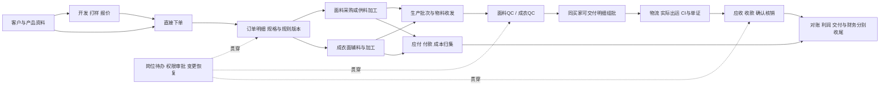

# 运营落地决策基线与首批方案

> **2026-10-07 职责纠偏：** 本文件的旧走查、旧权限和历史案例保留为当时证据；其中采购/仓储专岗、后勤独占库存或采购写权限的称呼已被最新分工取代，不用于后续设计与权限判定。 当前规则见[角色与实际分工](design/global/2026-10-06/05-roles-and-responsibilities.md)及[对话决策总账](design/global/2026-10-06/08-2026-10-06-对话设计决策总账.md)。

日期：2026-09-30。依据：本次用户语音讨论及当前源码抽查。
状态：业务决策已确认；技术方案为建议；源码发现不等于运行时故障复现。
本件不宣称软件已达标，不替换历史事实记录。与旧路线冲突时，以本次明确确认的业务方向为准。

## 一、已确认的交付基线

| 主题 | 当前决策 |
|---|---|
| 完整范围 | 面料、成衣的开发打样、报价、订单、采购、委外与生产跟单、QC、库存、物流、票据单证、业务财务、成本和经营分析；工厂设备排程、工位报工、工资计件不纳入本次主体范围 |
| 推进方式 | 共同基础复用，面料与成衣并行、同里程碑分别验收；不能面料完成后才开始成衣 |
| 设计依据 | 业务事实来自公司，系统不照搬历史操作惯性；专业机制由设计方提出，仅业务取舍交用户决策 |
| 规则优先级 | 合同明确约定 > 客户标准 > 公司默认，按具体条款覆盖；保留来源、版本，零与不适用不视为缺失 |
| 规则生效 | 报价、合同/订单、检验各自保留适用版本；重要变更评估影响并审批，不静默改写历史；普通个人偏好不套高风险审批 |
| QC | 面料与成衣分别设计检验内容、判定和报告，共用任务、审批、附件和审计；开发确认不等于生产/出运放行 |
| 交付颗粒度 | 订单、明细、生产/检验/出运批次明确关联，批次可独立推进；合同要求齐套时按约定限制 |
| 出运与 CI | 同一买家多个订单的部分明细/数量可组成本次出运；CI 来源于实际交付，保留原合同明细及价格依据；一张 CI 不跨买家；买家与收货方分离 |
| 币种 | 销售出口默认 USD，采购默认 CNY；国外客户指定国内交付可约定 CNY；只覆盖 USD/CNY，不按地址自动改币种 |
| 溢短装 | 使用上述规则优先级；中途欠交是待交余额，最终收尾判断短装；业务人员确认尾数收口，容差外审批；交付结束与财务结清分开 |
| 财务 | 收款独立记录，按 CI 分配核销，支持多对多及定金抵扣；系统建议、财务确认；不明确款项待认领；差额分类处理，不直接抹平 |
| 采购委外 | 支持成品直采、物料采购、加工服务及多供应商协作；归属、位置、质量、占用分离；发料、耗用、损耗、产出、余料可对账 |
| 成本 | 预计、承诺、实际分别保留并对比；成本与付款分离，共用费用有分摊依据，未结费用不作零；原币与折算依据留存 |
| 财务范围 | 完整业务财务与对账，衔接正式财务账套；首阶段不自建完整总账和税务申报系统 |
| 单证物流 | 支持直发、自有仓、货代仓等实际路径，不虚构入库；单证共用事实并保留正式版本；对外发送/提交由授权人员确认 |
| 权限审批 | 岗位、数据范围、操作权限共同约束，人工/Agent 一致；高风险原则上不自批，特殊自批须预授权、限范围、留痕；批准绑定版本和范围 |
| 异常处理 | 变更、取消、返工、索赔经过影响分析和授权执行；只限制受影响范围，保留原事实，不自动扣款或删除历史 |
| 开发入口 | 来样、询价打样、老客户直接下单均可；一个开发项目可产生多个产品/版本/订单，成熟产品复用而订单保留快照 |
| 岗位交接 | 明确负责人、截止时间、缺项、阻碍和下一步；任务随业务更新，不能靠聊天搬运关键数据、重复记账 |
| 上线切换 | 新开发/报价/订单从起点进入；在产、近完结旧单按原方式收尾，不要求全量迁入；新单使用旧库存仅接入核实的相关数量和来源 |
| 报表范围 | 过渡期明确系统内业务口径，不冒充公司全量业绩；同一业务只维护一个正式依据 |
| AI 等能力 | 保留 Agent、邮箱、知识库、门户最终目标；人工界面完整闭环优先，自主代办单独验证后开放 |

## 二、验收约束

**成品交付原则（用户再次强调）：** 模块、服务或入口存在仅是代码资产，不能判定能力可用。每个交付项以岗位用户的完整操作为单位，必须同时具备前端可发现性、功能内部完整度、跨模块连续性和正确的业务结果。

- 操作链逐步检查：从哪里进入 → 看见哪些业务信息 → 如何新建/编辑/选择 → 校验和权限反馈 → 提交成功或失败反馈 → 列表/详情/关联数据一致 → 下一岗位接手 → 修改、撤销、异常与续办。
- 产品状态必须覆盖空数据、加载、无权限、缺资料、处理中、失败、成功；界面提供明确下一步，不能靠开发口述隐藏路径。
- 体验检查包括术语、单位、状态、按钮行为的一致性，以及搜索筛选、上下文保留、适用的批量处理和单据预览输出；逐项依据真实岗位任务判定必要性，不机械堆功能。
- 每批交付同时包含必要的数据/API、前端操作、岗位交接与异常恢复；不能以“后端完成、界面以后接”宣告该能力交付。
- 验证从普通岗位账号的实际界面开始，再向后追踪数据与服务。源码地图负责定位，浏览器操作及业务结果负责证明可用。

1. 先从业务规则确定预期，再对照实现；不能按当前程序输出反写正确答案。
2. 面料、成衣分别以同组案例跨岗位持续推进，不中途替换补好数据，不靠改库或临时接口走通。
3. 既验主链，也验各功能适用的查询、录入、修改、审核、撤销、追溯、输出。
4. 验收交接、退出后续办、业务变更向下游传播，以及角色范围、并发、重复操作、断网重试和恢复。
5. 关键资料重复录入、找不到下一步、岗位交接断开属于交付缺陷，不降为轻微体验问题。
6. 内部验证后由普通岗位人员独立执行；复验者与实现者分离；修复需重验受影响上下游。
7. 证据绑定候选版本、环境、岗位、输入、预期、实际结果和日志/截图。历史通过不自动适用于当前版本。
8. 错账、错货、越权放行、丢数据、核心操作阻断及关键交接断点为阻断项；其余缺陷明确影响和处理安排。
9. 同一候选发布版本验证构建、升级与恢复后，面料/成衣代表岗位承接新真实业务试运行；预设支持责任和暂停条件，不能用旧备份覆盖新业务。

## 三、首轮源码核查结果

本轮未执行应用、测试或数据库操作；下表仅为源代码证据及风险解释，不是完整模块审计。

| 发现 | 证据 | 判断与下一步 |
|---|---|---|
| 已有业务事件、持久化与通知，不应重建孤立任务系统 | `server/src/events/businessEventBus.ts`、`server/src/notifications/eventBindings.ts` | 复用已有能力；核查岗位任务的责任人、完成条件、恢复和 UI 消费路径，不能以通知存在证明交接完成 |
| 订单状态事务提交后才发布事件，发布失败被隔离 | `server/src/orders/orderLifecycleService.ts` 状态转换后的事件发布 | 存在业务提交与事件持久化之间的故障窗口；已有事件重放不等于能恢复从未入库的事件。检查补偿机制后确定事务内 outbox 等方案，不贸然替换总线 |
| BOM 确认可自动生成采购草稿，但该路径将全部物料放入一张无供应商的采购单 | `server/src/events/linkages/L7CreateProcurement.ts` | 自动草稿不等于完成多供应商采购交接；应核实需求拆分、合并、负责人及加工服务路径 |
| PurchaseLine 表本身无来源订单行/BOM 行分配字段 | `server/prisma/schema.prisma` 的 PurchaseLine | 不能据此直接判定无关联；须继续检查 EntityLink、中间表和服务消费者，明确数量/成本追溯后再设计迁移 |
| 开发转单已有确认来源和规格快照，仍有单一 linkedOrderId 回写 | `server/src/development/convertService.ts`、`developmentCaseMutationService.ts` | 保留现有快照能力；核查多结果、多订单关系与重试去重，不能把单字段观察当成完整模型结论 |
| 自动核销执行器会直接调用核销服务；规则默认开启 | `server/src/events/linkages/L5AutoAllocate.ts`、`server/src/config/automationConfig.ts` | 与本次确认的“建议匹配、财务确认”存在设计冲突。运行配置和调用权限未核实；下一步核查所有核销写入口，形成统一的建议→确认→执行契约 |

## 四、首批方案草案：开发/直接下单至采购与生产准备交接

目标：销售完成确认后，采购和跟单能在各自入口接着工作，正确取得来源、规格、需求和阻碍；缺少审批或条件时不得误视为可以开工。

### A. 交接契约（建议，待与现有模型对照）

- 来源：开发结果/报价版本、订单明细及适用规格/规则版本。
- 需求：采购物料或加工服务、数量单位、需求日期、供料方式及分配关系；不能把采购草稿直接当已批准采购。
- 责任：责任岗位、具体负责人、协作人、截止时间；无人承接必须可见并进入分派队列。
- 执行：当前缺项、允许动作、阻断依据、后续业务对象；任务完成应由业务事实验证，不能仅点“已读”。
- 一致性：业务事实与可靠交接记录同步保证，消费去重、可重试、失败可追踪；沿用现有事件系统并补齐缺口。
- 变更：关键来源版本变化时重新计算受影响需求/任务，已下采购或已开工部分进入变更处置，不覆盖历史。

### B. 双线验收场景（计划，均未执行）

| 编号 | 场景 | 关键预期 |
|---|---|---|
| F1 | 面料老客户直接下单→成品采购准备 | 不强制新建开发案；采购能接收准确规格、数量、期限、来源，无重复录入 |
| F2 | 面料开发确认→报价/订单→供料加工准备 | 确认版本可追溯；原料需求和加工需求分开，多供应商归集不混单位 |
| G1 | 成衣多轮开发→确认版本→订单 | 颜色/尺码配比正确；选定版本明确，后续档案修改不影响已确认订单 |
| G2 | 成衣订单→面辅料与加工准备 | 多供应商需求可分派、部分推进；阻断范围准确，订单确认不等于生产放行 |
| X1 | 客户/公司默认标准修改 | 已确认业务不静默变化；新业务按生效规则解析，显示来源 |
| X2 | 已确认订单数量/规格变更 | 采购、生产准备任务重新评估；既有采购不可被静默覆盖 |
| X3 | 重复确认、并发承接、事件记录或消费失败 | 不重复采购/任务；失败可见且可恢复，不要求改库 |
| X4 | 角色交接、退出续办、无人负责 | 下个岗位看见任务及必要资料，无权数据不泄露；无人负责显式进入待分派 |

### C. 实施依赖与优先级

1. 先补证据：运行配置、已有待办入口、需求关联真源、事件补偿、所有核销写入口。
2. 同时核查高风险：定金生产入口、财务口径、迁移初始化/存量升级路径；不等待主链走到末端才核查。
3. 提出最小完整改造：基于现有服务定义可靠交接、需求分配和财务确认契约，列清数据迁移影响。
4. 同批完成服务/API、角色界面和回归，面料/成衣一起取证；不先做长期脱离业务的底层重构。
5. 新需求或旧结论冲突回到本件明确调整，禁止以更新测试基线代替解决业务缺陷。

## 五、本轮交付与限制

仅新增本方案文档，未修改原 handoff、业务代码、配置或数据；未部署、未运行测试。
未宣称完成全系统缺口映射或实现审计；首批证据为静态抽查。
排期在完成上述依赖核查后给出，不沿用旧路线的三天上线承诺。

## 六、全局能力与交接图（首版，静态证据地图）

本节为全局范围校准，未完成运行验收。下列“已有入口/服务”只证明源码存在；不等于正确可用。原计划首批三个断点只是样本，不能代替全系统优先级判断。

这是依赖与追溯图，不是强制串行流程：开发报价可并行，定金可先于出运，异常可在各环节发生，采购付款依合同执行。

| 业务域 / 责任岗位 | 已定位的源码入口 | 交给下一岗位的必要内容 | 当前证据与核查重点 |
|---|---|---|---|
| 客户/产品 / 销售、资料维护 | RelationsManager、ProductsManager | 买家/收货方、产品版本、客户条款 | 待验证：默认规则逐条继承、权限和版本锁定 |
| 开发/样品/报价 / 开发、销售 | DevelopmentManager、SampleManager、QuotationManager；development/convertService | 接受版本、规格、样品证据、订单来源 | 部分源码抽查：确认来源与快照已有，多结果多订单待核 |
| 订单 / 销售、跟单 | OrderManager；orders/orderLifecycleService | 行数量、尺码、交期、规则及责任人 | 部分源码抽查：状态审计已有，可靠交接窗口待补证 |
| 采购/BOM/委外 / 采购、跟单 | ProcurementManager、BomManager；procurementService、L7CreateProcurement | 分供应商需求、供料方式、数量与成本来源 | 部分实现证据：自动单草稿已有，需求拆合及服务采购待核 |
| 生产准备/跟单 / 跟单 | production/stageService、releaseService；MesManager | 批次产量、条件、进度与验货任务 | 待验证：轻量跟单与MES入口边界、定金生产门禁、批次粒度 |
| 两类QC / QC、业务批准人 | QcWorkbenchManager；qcService、qcChainService | 适用标准、实测、处置、批次放行依据 | 部分源码抽查：通用报告含幅宽/AQL，双线完整度待核 |
| 库存/委外物料 / 仓管、采购、跟单 | InventoryManager；inventoryService、inventoryOwnershipService | 位置、归属、可用/占用、耗用及余料 | 已定位货权服务；成品入库、转化及委外流水不沿用旧结论，逐路径验证 |
| 出运/物流 / 跟单、物流、单证 | ShipmentManager；shipping 服务 | 来源行批次、实际数量、物流节点、柜票关系 | 已定位拼柜只读聚合；新柜实体写链、跨单部分交付、并发预留待核 |
| 单证/关务 / 单证 | DocumentCenter、CustomsManager；templates、customs | 来源数据、正式版本、核对结果、对外确认 | 待验证：跨单CI、修订传播、正式发送权限与单证一致性 |
| 财务/成本 / 财务、管理者 | FinanceManager、PricingManager、ConsistencyWorkbench | 应收应付、核销分摊、成本、差异与余额 | 部分源码抽查：自动核销与新原则冲突，生产配置未核；币种/成本语义待全消费者核查 |
| 索赔/变更 / 销售、采购、QC、财务 | ClaimManager；claims 服务及订单变更服务 | 影响范围、授权处置、财务调整依据 | 服务存在，跨域完整闭环待验证 |
| 日常协作/经营视图 / 各岗位 | CockpitManager、NotificationCenter、Dashboard、ReportCenter | 可执行待办、负责人、阻碍、续办入口 | 通知已有；日常任务完整度待核。handoverService 是离职资产移交，不作日常交接完成证据 |
| 客户协作 / 客户、销售、财务 | customer/reconciliationAckService、documentService | 单据访问、进度、对账反馈 | 已定位对账回执服务，旧台账“纯只读/无回执”需重新核实；前端/挂载/权限未验 |
| 发布与恢复 / 运维 | CI、打包脚本、drill-backup-restore | 版本身份、升级结果、可恢复数据 | 脚本已有，候选版本实测待做；不能用历史通过替代本次证据 |

### 全局优先级与交付批次

- P0：核查并处理已证实的错账、错货、越权、数据丢失和关键断链。当前观察首先作为风险项复现，不能把猜测报成已发生故障。
- P1：进入跨域共同依赖的能力，如规则版本、明细分配、可靠事件和岗位任务、审批范围；通过双线业务场景落地。
- P2：补齐承诺范围的功能内部动作与岗位效率；影响独立完成工作的缺项按P0/P1提升，不能统称体验。
- 后续层：Agent、邮箱、知识库、门户扩展保留最终目标，与人工业务投用门槛分别验收。

| 批次 | 面料与成衣共同交付 | 必须看见的业务结果 |
|---|---|---|
| M1 | 开发/直接下单→确认→采购与生产准备交接 | 下个岗位有准确需求、责任人、阻碍和可执行动作；F1–G2及X1–X4通过 |
| M2 | 采购/委外→物料与生产→两类QC→可交付数量 | 多供应商、耗料、批次和不合格处置可追溯，可交量可信 |
| M3 | 多单部分组批→物流→CI/单证→收付款/成本→收尾 | 数量、金额及来源分摊贯通，财务确认与变更闭环成立 |
| M4 | 同一候选版本跨岗位完整复验→双线新业务试运行 | 普通岗位独立操作，部署升级恢复通过，支持和暂停责任明确 |

M2/M3 的高风险检查和契约设计从现在开始，不能排到后面才发现；批次表示完整验收顺序，并不要求所有工作串行。发布恢复贯穿每批。

### 下一步核查清单

1. 追踪现有岗位入口和实际操作路径，建立任务事实与通知关系，不创建第二套业务状态。
2. 验证事件持久化、重放、去重和无事件时的补偿范围，再确定可靠交接改造。
3. 全量查采购需求关联与核销写入口，先把契约和权限对齐，再定迁移与代码范围。
4. 对旧台账标缺项但已有服务的库存/客户回执等，完成挂载、前端、权限、运行验证后分类。
5. 在隔离测试环境取证，更新本表当前状态；不由文件数量或自动化测试数量推导完成率。

### 现场走查补充：前后端交叉取证（2026-09-30）

用户补充问题仅用于校准，不中断当前贯穿案例。每项结论分别记录页面观察、组件与请求、后端校验与落库、后续岗位操作；未验证层明确标记，不以代码存在或单页未见推导功能完成或缺失。

- 本地环境：页面显示 panda_hub_local，普通销售岗位 Vivian Chen；模拟面料开发案 AUDIT-0930-F01，名称“验收专用—面料供料加工闭环”。已通过页面创建并添加试样工厂，重新打开浏览器后仍能读取，继续用于同一链路。尚未完成样品、订单及采购交接验收。
- 更正入口判断：开发单新建支持面料/成衣切换及成衣专属字段；此前直接录入订单的观察不能外推为开发单缺少品类选择。
- 成衣尺码：直接建单表单未显示尺码分配；字段字典 lib/orderSchema.ts 明确 shownInManualForm=false、shownInDetail=true，OrderManager 保存编辑时传递 sizeBreakdown，后端可写字段及查询映射也包含它。因此当前结论为“创建入口未覆盖，详情编辑及贯穿保存待实测”，不是“系统无尺码功能”。
- 面料样品登记：页面要求先添加试样工厂，已添加后可选择归属工厂。请求经 developmentService.createSampleBatch 到 development/route 的写权限入口，fabricDevelopmentService 使用事务创建批次及审计，且仅接受面料开发案。岗位接手及重复请求行为仍待验证。
- 色样评级风险：SampleBatchesPanel.resetCreate 默认 createRating=4，doCreate 对 lab-dip 无条件发送 colorRating；后端 createSampleBatch 接受并保存该值，允许缺省为 null。页面登记待制作样品时不应静默产生实测评级。当前为页面及静态请求链共同证据，尚未提交批次复现落库；建议区分“未检验”与实测评级，后续纳入修复验收。

无业务代码修改；以上不是 M1 验收通过声明。

### 连续案例实测结果与首批修复契约（续）

本轮全程使用本地测试库销售岗位及模拟案 AUDIT-0930-F01；未修改业务代码、未通过数据库/API补单救场。

| 发现 | 当前证据与影响 | 修复方向与验收 |
|---|---|---|
| 色样未检验已有评级 | 未点评级直接登记 SB-20260930-7CAE；刷新重新进入仍为“待打样 / 评级4”。前端默认值经请求写入后端，已从静态风险升级为运行复现 | 未检验必须为空；实测动作显式录入，回读、报告和转档不得把缺省当评级 |
| 批次设计确认与业务认可混用 | 待打样直接“确认批次”成功，再“转面料档案”成功，随后“确认开发完成”成功。后端 confirmSampleBatch 不检查制作/客户反馈阶段；convertToFabricAsset 接受 status=approved 或 confirmStatus=confirmed；开发完成允许 developing→approved | 分开设计归组确认、样品完成、内部/客户认可、可下单依据。可提前建档时保留未认可状态，不能因已建档便视为开发成果获认可。生产放行另验，本轮未证明可绕过生产放行 |
| 开发转单后销售找不到新单（首批阻断） | UI 转单成功，生成 PO-AUDIT-0930-F01-1790744741076；点已转订单仅到列表，全部分类搜索无结果，刷新仍无结果。该内部开发案无客户；convertService 创建订单 customerRelationId=null 且未写 ownerId；订单列表范围要求可见客户或无客户且 ownerId=当前用户。App.handleOpenOrderById 只从可见列表寻找，无命中不提示 | 转单前明确草稿/正式订单边界，缺客户时给可补资料入口；建单统一写责任人及可见范围，不能绕开授权。跳转按目标定位，失败明确说明。原销售创建→点击打开→补资料→确认→下一岗位接手，必须同账号实测；不得用管理员账号掩盖 |
| 父子面板状态不同步 | 新增批次后上方总数仍0，下方已有批次；确认后上方确认数仍0，下方已确认；重新进入或转档触发刷新才一致。SampleBatchesPanel 仅 load 上报 onCountsChange，局部 setBatches 未统一上报 | 单一衍生统计或统一回读；新增/确认/复样/转档后无需刷新即一致 |
| 成衣尺码能力更正 | 打开既有测试订单 SIM-PO-1054/0001，成衣生产跟单实际显示 S270、M540、L540、XL324、XXL126，合计1800。也有面辅料用量。此前“不存在尺码”的推断撤回 | 已验证详情展示；新建入口、编辑保存、不同订单行隔离和采购衔接仍待验证，不宣称完整通过 |

首批改造优先顺序：先解决转单责任/可见范围/失败反馈，再统一确认语义与版本依据，同时补未检验空值和父子状态同步。面料异常路径已经卡在转单后接手；不以继续点其他模块替代该案例通过。成衣仍并行核查独立入口，完整主链验收尚未通过。

截图证据保存在 /tmp/bambook-audit-0930/：pending-confirmed.jpg、pending-converted.jpg、development-confirmed-pending-sample.jpg、converted-order-invisible.jpg。均为本地模拟业务；临时目录证据需随正式验收归档。

### 首批代码修复与复验（2026-09-30）

本节覆盖前文“未修改代码”的历史记录；现在已实际修改，尚非全系统验收通过。

- 转单：创建时写入操作人作为订单负责人，采购人民币、销售美元、面料米及成衣件默认值。打开关联订单按 ID 读取并保留权限范围校验，失败显示原因；兼容历史大小写品类。负责人写入及事务失败路径已由定向测试验证，新开发从认可到转单的同账号完整正向页面案例仍待复验。
- 认可：待打样或仅设计批次确认不允许批次转档；确认设计批次要求样品已认可；成衣转换节点必须 approved。面料开发完成和转单要求已认可并转档的批次或已转档封样。封样封存必须全部来源批次认可。历史错误认可/档案未自动改写，需单独评估数据修复，不把旧错误记录当新验收依据。
- 未检验与统计：新色样默认评级为空，实测允许显式清空；批次变化统一派生上报统计。普通销售账号登记 SB-20260930-BDB6，未选择评级，保存后无评级，上方批次数立即从1变2；旧待打样批次无设计确认或转档入口。
- 直接建单：显式选择品类；供应商、收货方与结款方使用中性口径；允许供应商暂缺的待确认订单；成衣录入款号与尺码，数量为非负整数且合计匹配订单量。普通销售账号创建 AUDIT-0930-G-REPAIR，款号 AUDIT-G-STYLE，100件、S60/M40、无供应商；错误合计被拦，保存后列表及详情重新进入均能读回。
- 追加修复：新建行后选中了缺少 lines 的父单对象，造成实际已保存尺码在首屏看似丢失；创建和编辑后的选中对象改为合并完整明细的父单。

验证：前后端 TypeScript 检查通过，前端正式构建通过。后端6个定向文件120项通过，追加封样回归后单文件31项通过；前端批次行为、订单布局、行服务等定向检查通过。原 handoff 文档已有改动未覆盖。

截图：/tmp/bambook-audit-0930/garment-repair-readback.jpg、sample-repair-readback.jpg。测试对象留在本地测试库，未对外发送或用管理员补数据救场。

下一步先补本批转单正向页面复验与历史非法记录处理，再继续采购及生产准备。订单事件可靠交接、岗位任务、多供应商需求分配及财务人工核销仍需处理，不能由本批通过推定它们已完成。

#### 转单正向复验补充（同轮）

已完成前文待做的正向转单页面复验：销售 Vivian Chen 新建 AUDIT-0930-F02；无成果时确认开发完成被拒绝。按 pending→making→sent→approved 推进模拟批次 SB-20260930-D3FB（快递号 AUDIT-NO-REAL-SHIPMENT，反馈明确标为测试），转面料档案后确认开发完成，生成100米、2026-11-15交期的 PO-AUDIT-0930-F02-1790747002210，点击关联订单同账号成功打开。缺客户的内部开发草稿显示“订单未关联客户”及补齐入口，不视作正式可履约订单。截图 converted-order-repair-open.jpg。

实际数据库验证拦出了本轮新增的单位误写订单头问题（模拟测试未识别 Prisma 列约束）；已删除订单头 unit，仅写 OrderLine，并追加断言，重新加载后端后真实转单成功。此证据再次说明测试不能替代运行落库验证。未以改库修旧测试记录代替验收。

最终定向回归：后端6文件121项、前端4文件14项通过，前后端类型检查及前端构建通过。本轮代码尚未提交或部署到生产。

### 第二批修复：收款确认与订单交接记录

- 收款登记的 L5 联动改为只读建议，保留原配置标识，但不再调用核销写服务。财务页面增加“获取匹配建议”，建议只选入发票，必须明确点击确认核销。建议接口校验权限和可见范围，跳过删除凭证、不可核销发票及币种不符。
- 原回款认领接口可由仅有读取权限的销售直接写核销，现改为 invoices:reconcile 门禁；前端销售不可确认。通知同步改为已确认核销，避免实际已冲账却提示待复核。尚未建设“销售提交待审匹配申请”的持久化流程，不能把当前只读选择称为该流程完成。
- 订单生命周期的状态变化与交接事件使用同一数据库事务落入 AgentJob；事件写入失败则状态不提交，提交后复用同一事件 ID 派发。只覆盖该状态转换入口，不能推广为所有事件已具备完整可靠消费；消费者失败后的重试完成判定仍需补齐。
- 页面实跑发现核销成功后认领队列不刷新，且用默认分页发票列表替换全量快照导致汇总范围缩小。已改为刷新认领队列，并仅回读受影响的发票和凭证合并到原列表；刷新失败提示已核销、勿重复提交。移除认领页不相关的“共0张凭证”计数。

实际操作：本地 panda_hub_local、财务 Charlie Qian，新建 AUDIT-0930-FIN-MANUAL（100 USD，关联 SIM-INV-2012）；保存后未核销、零核销明细；获取建议后仍待确认；明确确认后重新进入显示已核销100、一条明细。无真实银行支付或对外发送。第二笔 AUDIT-0930-FIN-REFRESH（10 USD）用于复验刷新修复。

测试：订单生命周期32项、权限35项、联动17项、核销与认领服务40项通过；前端认领操作3项通过（查看无写、建议无写、明确确认后队列刷新）。前后端类型检查、前端构建通过；构建存在包体积提示，不能视为性能验收。

仍未完成：采购明细的需求来源、跨供应商分配与采购岗位承接；面料/成衣完整链路及断网并发恢复验收。已核实 L7 目前把整张 BOM 转成一张供应商空白采购草稿，PurchaseLine 没有来源 BOM 行/销售行字段；应先补数量分配契约和明细来源，不能仅增加供应商下拉就宣称多供应商闭环。

刷新复验补充：10 USD 核销后队列自动由4笔变3笔，待收汇总同步减少10；同时发现发票详情接口不带 openAmount，前端合并后保留旧余额。已将发票及凭证详情统一补充派生余额，发票含贷项抵扣、凭证按实际核销合计，新增详情/列表一致性回归7项通过。此后端补丁尚待重载后的页面金额复验，不将之前截图当成余额完整通过。

最终金额页面复验已完成：最新后端下新增 AUDIT-0930-FIN-BALANCE（1 USD），保存仍为零核销；建议选入后由财务明确确认。待认领自动4→3，待收恢复24,048.90 USD，应收汇总583,207.40 USD，相对本批起点583,318.40正好减少三笔测试款100+10+1；应收笔数61、欧元汇总及应付6笔保持原范围。无需手动刷新或改库。截图 batch2-balance-final.jpg；前两笔凭证和页面刷新问题证据同目录保留。本批金额闭环复验通过，不代表采购及整系统通过。

### 第三批：采购需求承接、分配与收款续核销（2026-09-30）

本批将“有采购草稿”推进到可领取、核量、分供应商生成草稿和回看来源。仍不是采购收货、委外生产及全系统验收完成。

#### 已落地的交接契约

- 新增 ProcurementDemand 与 PurchaseDemandAllocation。需求保存订单/订单行/BOM行来源、单位、负责人、确认总量和版本；分配保存采购单/行、数量、状态及幂等键。BOM确认后生成待核量需求，不再把单件用量当作总采购量，也不自动生成无供应商的整张采购单。
- 采购页面新增需求与待办：领取、明确确认总量、分供应商采购、打开采购单继续补交期及条款。成衣件数、面料米数、辅料颗数分别保留。分页提供继续加载，并明确筛选只覆盖已加载范围。
- 生成采购草稿即占用需求；超量拒绝。未收货采购单取消/删除释放对应占用。已关联需求的采购行及来源不能直接改写，交期/付款等非来源字段仍能编辑。新版BOM遇旧版有效分配会拦截，不能悄悄再买一遍；完整的跨版变更处置仍未交付。
- 采购单状态写在事务锁内复核旧状态及更新时间，并复核路由授权时的来源订单，防止取消释放后被并发确认复活、或授权后换到别人的订单。
- PO、询价、退换货对象与列表按来源订单范围校验，列表在分页前过滤。预览按真实采购单校验，不再误拦本人单据。询价并发来源变更的锁内复核尚在收尾。
- 采购表单不再默默丢掉无效行；明确零单价允许，空单价/缺描述/缺单位/非正数量报错。编辑保留原BOM、分类和单位。

#### 同一案例的实际页面证据

均使用 localhost 的 panda_hub_local、Vivian Chen 普通岗位；没有真实发送采购订单或银行支付。

| 案例 | 页面操作结果 | 证据 |
|---|---|---|
| 面料 F02，100 Meter | 建需求→领取→确认100→吴江60生成 PO-2026-0001；再申请41被拦；绍兴40生成 PO-2026-0002。0001补齐交期、收货地址及付款条款成功。取消0002后仅释放40，0001的60保持占用 | batch3-procurement-terms.jpg、batch3-demand-release.jpg |
| 成衣 AUDIT-0930-G-REPAIR，100 Pcs / S60 M40 | 同一来源行分别建立157.5 M主面料及102 PCS纽扣需求；分别分配吴江及宁波，生成 PO-2026-0003、0004，各自余量0，来源仍为同一成衣行 | batch3-garment-demand.jpg |
| 收款 AUDIT-0930-FIN-APPEND，100 USD | 保存无自动核销；财务先确认60，再确认40，累计只有一条100核销明细；应收汇总减少100至583,107.40 USD；其他币种/应付范围不变 | batch3-finance-append.jpg |

面料来源仍是缺客户的内部订单草稿；上述证明采购草稿操作与数量关联，不证明正式履约放行。成衣需求量为验收案例显式输入，并非已证明BOM自动算料完整。

收款追加核销使用新接口语义，保留旧替换式接口兼容。凭证事务内记录幂等回执，真实本地数据库重放第二笔40请求未增加核销、审计或事件；前端未知结果保留原请求供恢复。采购需求的跨页面未知结果恢复正在补齐，不能仅凭当前页面的重复点击防护宣称断网恢复完成。

#### 并发与验证证据

- 真实 PostgreSQL 隔离案例 AUDIT-CONCURRENCY-0930-1790751325929：3轮100需求同时分配两笔60，每轮仅一笔成功；刷新版本后再分60均因超量被拒。相同幂等键并发加两次重试只生成一张单，总计4张采购单且无孤儿单。测试用 inactive 独立账号，无真实角色授权；只证明服务事务，不代替HTTP权限测试。
- 脚本 server/scripts/audit-procurement-concurrency-20260930.ts 限制 localhost/panda_hub_local；日志 /tmp/bambook-audit-0930/procurement-real-concurrency.log。
- 截图均在 /tmp/bambook-audit-0930/，正式验收前需归档，不能依赖临时目录长期保留。
- 已运行17个后端文件295项通过，覆盖采购、事件、重试、核销与订单生命周期；前端4文件21项通过。之后的询价锁内复核/采购恢复补丁需重新验证，不沿用旧测试结果。
- 本地新增迁移 20260930170000_procurement_demand_allocation 已执行并登记；执行前 pg_dump 保存于 /tmp/bambook-audit-0930/checkpoint-before-demand/local-before-schema.dump。未迁移生产。

#### 必须继续处理的边界

事件失败已能留待重试，单次派发等待全部消费者；损坏载荷明确失败，积压分页继续消费。本批没有实现跨进程消费者抢占和持久化逐消费者回执，不能宣称全链路恰好一次。

采购待办目前为领取/确认/分配，尚缺转交、期限升级及生产准备岗位的完整接手；跨订单合并采购单、服务加工采购、BOM新版已有采购的变更处置和收料/成本连续验收仍未完成。历史非法样品认可数据未自动改写。下一阶段按这些明确缺口继续，不把其余“待验证”能力一概当作已坏或已完成。

#### 第三批收尾补充

- 询价所有写动作现已增加锁内来源、状态及更新时间复核；保留目标订单/BOM范围校验。补丁后17文件303项后端、4文件26项前端通过，前后端类型及构建通过。
- 采购未知提交结果现按用户和API后端保存原请求键与内容，卸载重挂仍可核对；超量/明确版本过期可修正重试，结果不确定的冲突保留原请求。恢复缓存不是业务真源，服务器仍判断结果。新增卸载恢复、用户/后端隔离、超量41改40的测试。
- 新增采购单“打开来源订单”，实际从PO-2026-0004回到成衣订单，款号及S60/M40仍完整。关联业务泛用面板的订单计数仍为0，不能把该计数作为来源关系真值，后续需统一其语义。
- 新的跨岗位页面案例：Vivian创建 AUDIT-0930-G 岗位交接织标 后不领取；切Hank（现有后勤角色，具有采购职责）后在待领取中可见，领取并确认105 PCS，以0.3 CNY分给苏州锦绣织标，生成PO-2026-0009（31.50 CNY）。预览显示同一数量金额和采购员Hank Zheng。证据 batch3-cross-role-demand.jpg、batch3-po-preview.jpg。
- 权限实情：目前没有独立采购角色；Hank现有订单scope为all，本批未扩大权限。上述证明现有岗位可接手未领需求，不证明按团队定向分派。受限岗位仍按来源订单范围读取，给需求分配负责人不能自行开放订单售价/利润。
- 已补本人退回队列接口与页面：POST /demands/:id/release，必填revision及reason，限当前本人、有采购写权限、来源可见且状态可处理；事务清负责人、增加版本、保留审计。已有PO、分配和数量不动。有结果未知的分配时前端禁止退回。52项服务/路由和15项前端流程测试通过；页面退回/另一岗位接手复验正在进行。

仍需后续建设团队接收队列、到期提醒、主管受控指派、专门的最小来源上下文，以及采购后段收料/加工/成本接续。本批没有以销售自己做完替代跨岗位证据，也没有新建角色或扩大权限来绕过交接问题。

退回页面复验完成：Hank为织标需求填写验收理由退回，版本4→5、负责人待领取；105 PCS占用及PO-2026-0009均保留。切Vivian重新领取，版本5→6，仍105已分配/0剩余且仅同一张采购单。截图 batch3-demand-unclaim.jpg、batch3-demand-reclaim.jpg。此操作仅解除本人任务领办，不等同主管任意转交或接收团队授权。

本批最终回归：后端17文件308项、前端4文件29项通过；前后端TypeScript通过，前端构建通过（仍有包体积提示，未完成性能验收）；改动代码路径diff检查通过。最新本地8081进程已加载退回补丁，未提交Git、未部署生产。不能据此宣布所有已知缺口清零或允许全公司正式切换。

### 第四批：从基础链路转向复杂作业包

详见同目录《采购收料到生产准备-复杂作业包验收-2026-09-30.md》。先定义面料分供分批、成衣面辅料、拒收退回、并发/失败重试的预期数量金额，再修复已证实错误。已修逐行收齐与拒收证据、收料事务outbox、L8原子入库/重放、拒收退回误扣合格库存及状态并发。普通页面实际验证成衣面料合格58/拒收2、退回2而合格库存仍58；真实PG验证跨单位收齐、同号并发及第二行失败整体回滚。

本批后端219、前端35项定向测试通过，前端构建通过；这里包含接线测试，数量不代表业务完成度。F/G全场景页面验收尚未完成。利润表采购全额与预付款重复计成本的具体证据列入作业包后续优先项；没有以本轮修复声称生产可用。
